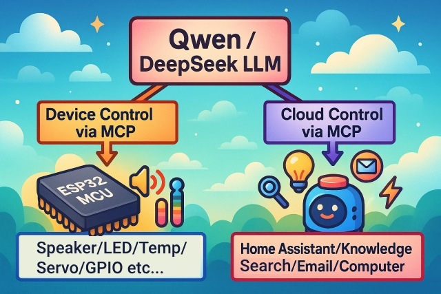
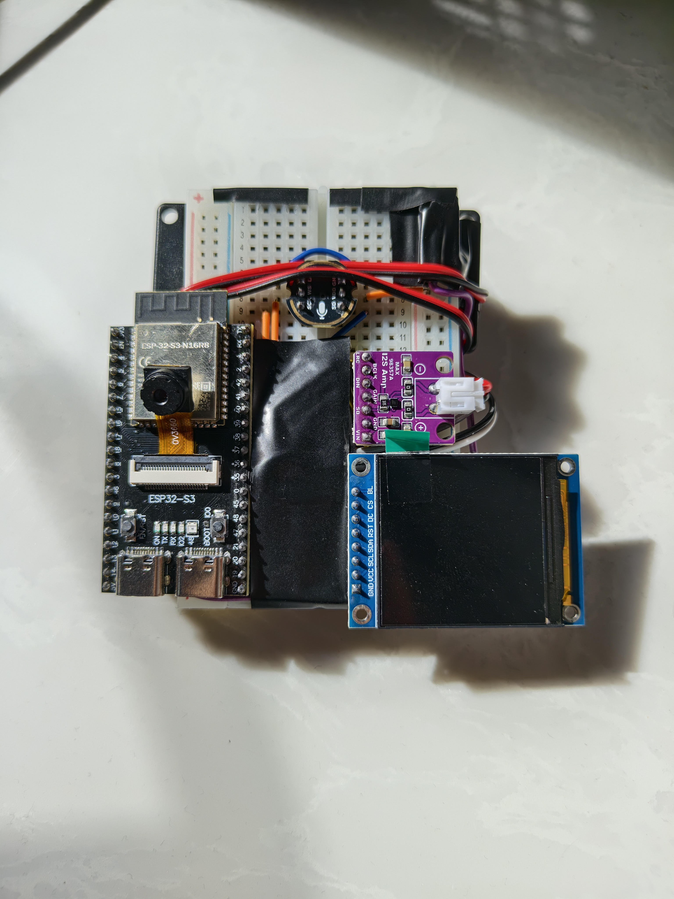
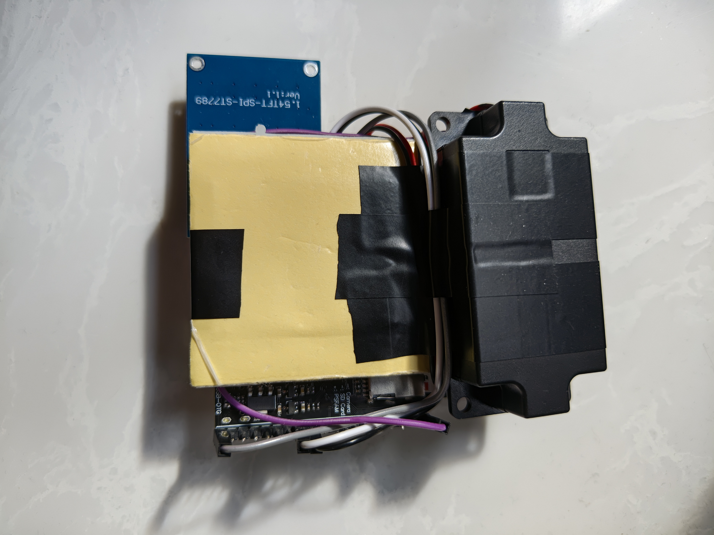
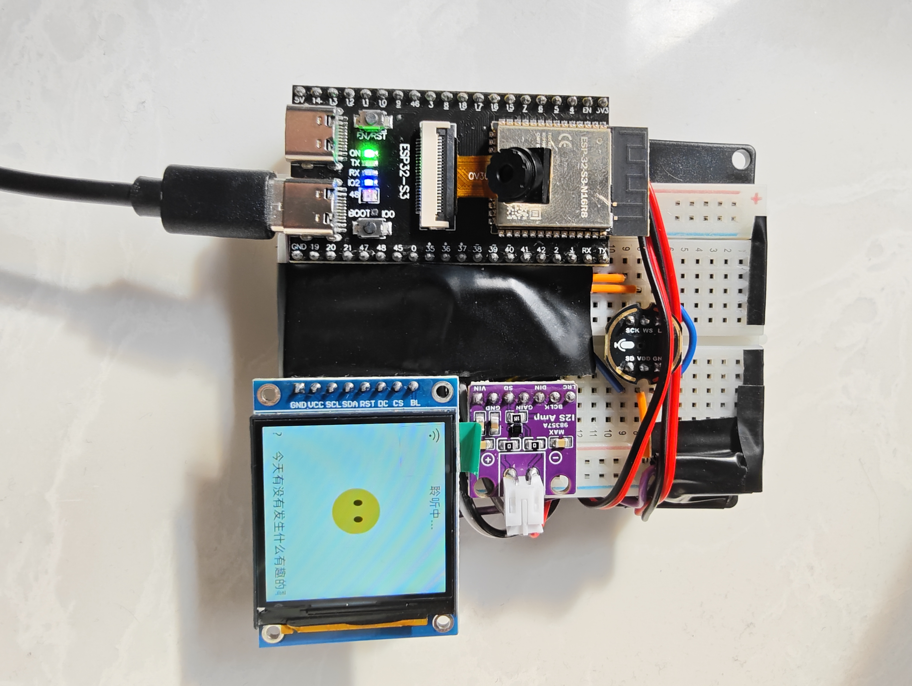
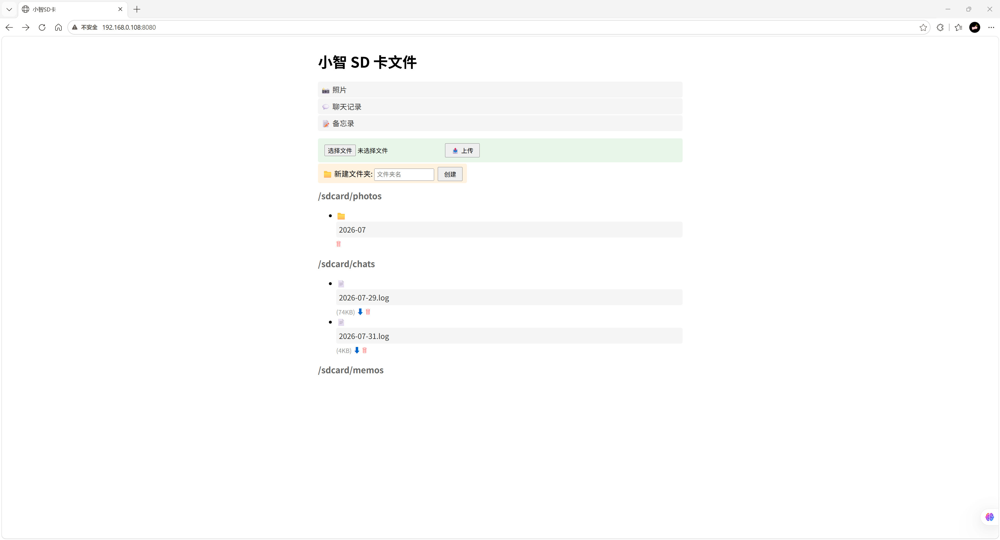

# 小智 AI 聊天机器人 — ESP32-S3 CAM 增强版

基于 [78/xiaozhi-esp32](https://github.com/78/xiaozhi-esp32) 开源项目，针对 **ESP32-S3 CAM 开发板** 深度定制的增强版本。

使用 AI 助手配置同款开发板时，可以加载 [小智 ESP32-S3 CAM 配置 Skill](.agents/skills/xiaozhi-s3cam-setup/SKILL.md)，核对接线、编译选项和双唤醒词设置。

👉 [人类：给 AI 装摄像头 vs AI：当场发现主人三天没洗头【bilibili】](https://www.bilibili.com/video/BV1bpjgzKEhd/)

小智 AI 聊天机器人作为语音交互入口，利用 Qwen / DeepSeek 等大模型的 AI 能力，通过 MCP 协议实现多端控制。



---

## 本版本硬件配置

| 模块 | 型号 | 接口 |
|------|------|------|
| 主控 | ESP32-S3 N16R8 CAM（44pin） | — |
| 屏幕 | 1.54 寸 TFT SPI ST7789（240×240） | SPI |
| 摄像头 | OV3660 | DVP 并行 |
| 麦克风 | ZTS6672 (兼容 INMP441) | I2S |
| 功放 | MAX98357A | I2S |
| 喇叭 | 8Ω 2~3W | — |
| 存储 | 板载 MicroSD 卡槽 | SDMMC 1-bit |

### 实物图

<div align="center">
  
  
  
  <p><sub>正面 · 背面 · 通电运行</sub></p>
</div>

## 引脚接线

| 模块 | 信号 | GPIO |
|------|------|------|
| 屏幕 ST7789 | MOSI / CLK / DC / RST / CS / BL | 20 / 19 / 47 / 21 / 45 / 14 |
| 麦克风 ZTS6672 | WS / SCK / SD | 1 / 2 / 42 |
| 喇叭 MAX98357A | DOUT / BCLK / LRCK | 46 / 3 / 41 |
| 摄像头 OV3660 | D0~D7 / XCLK / PCLK / VSYNC / HREF / SIOC / SIOD | 11,9,8,10,12,18,17,16 / 15 / 13 / 6 / 7 / 5 / 4 |
| SD 卡 (SDMMC) | CMD / CLK / D0 | 38 / 39 / 40 |
| BOOT 按钮 | | 0 |
| LED | | 48 |

---

## 新增功能

### 照片系统
- 拍照自动存 SD 卡，按年月分文件夹 `/sdcard/photos/2026-07/时间.jpg`
- 屏幕浏览照片：「看照片」「下一张」「上一张」「看第一张」
- 灵活定时拍照：「3 秒后拍一张」「每隔 5 秒拍一张拍 3 张」「停下」

### 记忆系统
- 聊天记录按天存储 `/sdcard/chats/日期.log`，每次开机自动加分割线
- 搜索历史对话：「搜一下之前关于 XX 的聊天」
- 回顾最近对话：「我们刚才聊了什么」

### 语音备忘录
- 「帮我记住：大门密码是 8888」→ 存到 SD 卡
- 「大门密码是啥」→ 自动回想
- 「我记了哪些东西」→ 列出所有备忘

### 多唤醒词
- menuconfig 里用分号 `;` 分隔，同时识别多个自定义唤醒词
- 例如：`小智小智;小智同学;嘿小智`

### WiFi 网盘
- 浏览器访问 `http://小智IP:8080`，无线管理 SD 卡
- 浏览 / 下载 / 上传 / 删除文件和文件夹
- 无需拔卡，电脑和手机都能访问



### 屏幕优化
- LVGL 软件旋转（左转 90°）
- 摄像头预览镜像修正

---

## 上游功能概览

本项目继承上游 [78/xiaozhi-esp32](https://github.com/78/xiaozhi-esp32) 全部功能：

- Wi-Fi 网络连接
- 离线语音唤醒 [ESP-SR](https://github.com/espressif/esp-sr)
- MQTT + UDP / WebSocket 双协议
- OPUS 音频编解码，流式 ASR + LLM + TTS
- 声纹识别 [3D Speaker](https://github.com/modelscope/3D-Speaker)
- LCD 表情与情绪呈现
- 多语言支持
- 设备端 MCP（音量、灯光、GPIO 控制）
- 云端 MCP（智能家居、PC桌面、知识搜索、邮件收发）
- 自定义唤醒词/字体/表情 ([Assets 生成器](https://github.com/78/xiaozhi-assets-generator))

---

## 编译

```bash
# 环境: ESP-IDF v5.5.4
idf.py set-target esp32s3
idf.py menuconfig
```

menuconfig 配置：
```
Xiaozhi Assistant
  → Board Type → Bread Compact WiFi + LCD + Camera
  → LCD Type → ST7789 240x240
  → Wake Word Type → Multinet model (Custom Wake Word)  [可选]
  → Custom Wake Word → xiao zhi xiao zhi; xiao zhi tong xue  [可选，多个用分号分隔]
```

```bash
idf.py build flash
```

---

## SD 卡文件结构

```
/sdcard/
├── photos/
│   └── 2026-07/
│       ├── 20260729_141917.jpg
│       └── 20260729_150440.jpg
├── chats/
│   └── 2026-07-29.log
└── memos/
    └── 大门密码.txt
```

---

## 致谢

本项目基于 [78/xiaozhi-esp32](https://github.com/78/xiaozhi-esp32) 修改，感谢原作者 [78](https://github.com/78) 及社区贡献。
